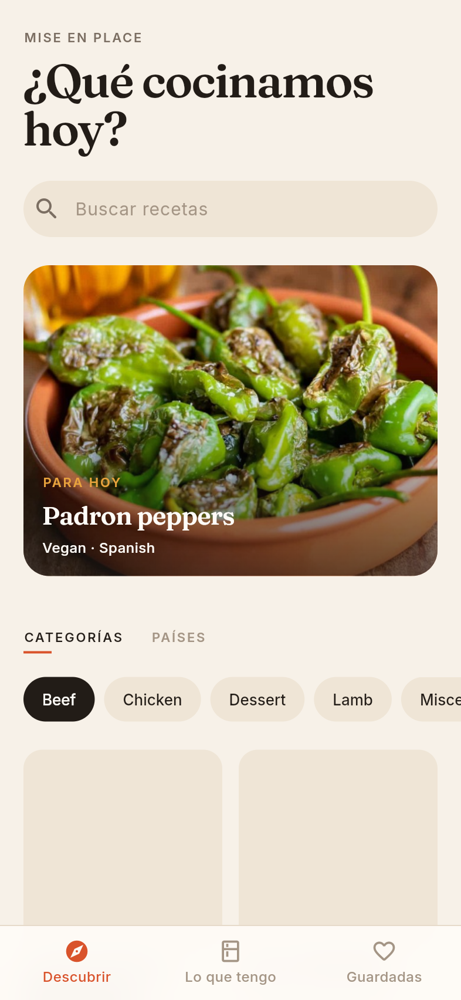
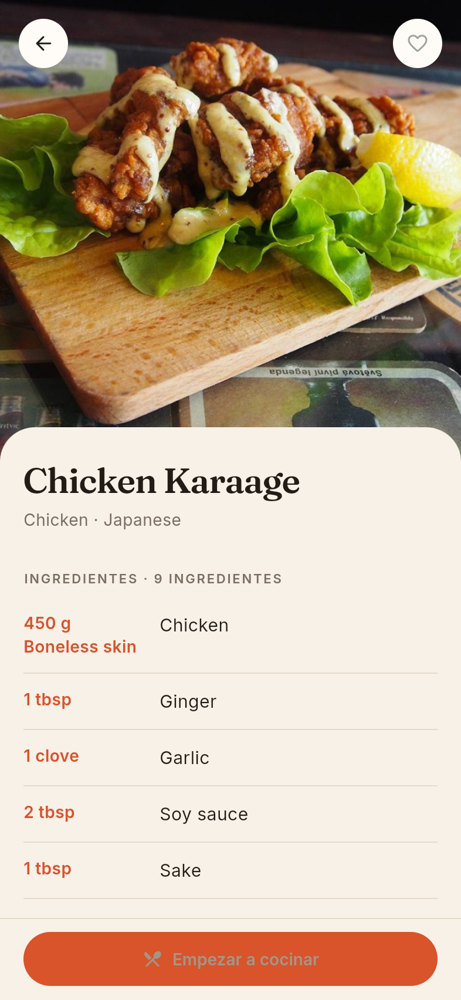
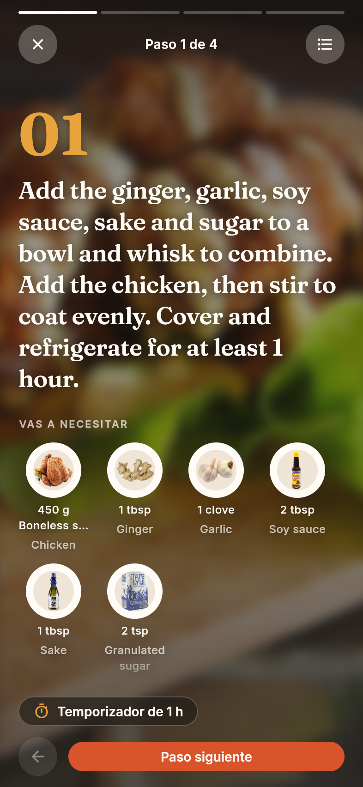
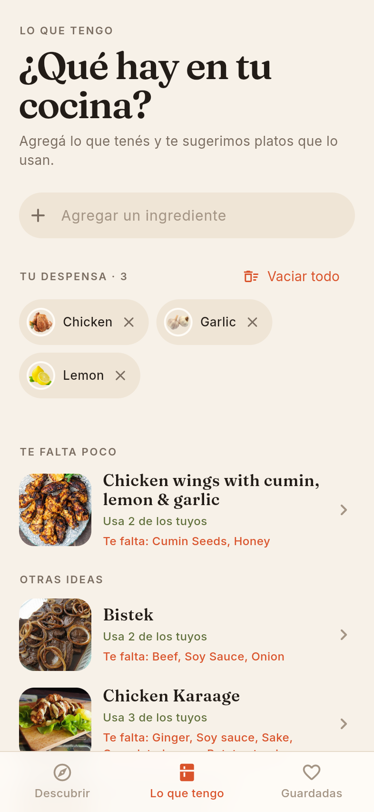

# Mise

[](https://github.com/gryllifish/mise/actions/workflows/ci.yml)
[](LICENSE)

A recipe finder built with Flutter on a **live public API**
([TheMealDB](https://www.themealdb.com)), with **offline saved recipes**,
a **story-style cook mode** and **recipes from what you have at home**,
on a production-grade architecture.

**[▶ Try the live demo](https://gryllifish.github.io/mise/)** (web build;
on a desktop it opens inside a phone frame).

| Discover | Recipe | Cook mode | What I have |
|:---:|:---:|:---:|:---:|
|  |  |  |  |

## What it shows
- **A real network API, handled properly.** Typed errors for offline,
  timeouts and server failures, each with a localized message and a
  retry; transient failures (including TheMealDB's 429 rate limit) are
  retried with backoff; bursts are capped at four requests at once.
- **Debounced, cancellable search.** Typing waits 350 ms; a newer query
  cancels the request in flight, so a slow old answer never overwrites a
  newer one ([`discover_controller.dart`](lib/features/recipes/controllers/discover_controller.dart)).
- **Offline.** Saved recipes live on the device (Hive, IndexedDB on the
  web). When the network fails, a saved recipe opens from its saved copy
  with a notice. If storage itself hangs, the app falls back to memory
  instead of a blank screen.
- **Cook mode, story-style.** One step per page over the dish photo, with
  the ingredients each step mentions (as cut-out photos) and a timer when
  the step names a duration ("simmer for 10 minutes"). The timer keeps
  counting across steps and comes from the clock, not from ticks
  ([`cook_step.dart`](lib/features/recipes/domain/entities/cook_step.dart),
  [`cook_timer_controller.dart`](lib/features/recipes/controllers/cook_timer_controller.dart)).
- **What I have.** List the ingredients at home and get dishes grouped by
  how ready you are: ready to cook, almost there, more ideas, each saying
  what's missing. The free API filters by one ingredient at a time, so
  the app fetches each one (and catalog variants like "Egg" and "Eggs")
  and ranks recipes itself ([`pantry.dart`](lib/features/recipes/domain/entities/pantry.dart)).
- **Browse by category or by country**, with recipes kept per choice so
  switching back is instant.
- **Motion with purpose:** the photo flies from the card into the recipe
  (`Hero`) and shows before the full recipe loads; grids rise in
  staggered; bottom bars hand over between pages instead of stacking up.
- **Accessibility:** honors "Reduce motion" (transitions, the cook mode
  zoom and every entrance switch to instant), semantic labels and
  actions (swipe-to-remove has a screen reader action), 48 px targets,
  and fonts bundled with the app.
- **Clean architecture:** feature-first layers, repository pattern,
  `Result`/`Failure` errors, Riverpod controllers. No business logic in
  widgets.
- **i18n:** English and Spanish.

## Architecture
```
presentation → controllers → domain ← data
  widgets       @riverpod      entities   DTOs, data sources,
                notifiers      repo       repository impls
                               interfaces
```
- **State/DI:** Riverpod 3 with code generation.
- **Network:** Dio, mapped to typed `AppException`s inside `data`; the
  rest of the app never sees Dio (cancellation goes through a
  framework-free `CancelSignal`).
- **Storage:** Hive boxes of JSON, opened at startup with a timeout and an
  in-memory fallback.
- **Models:** freezed + json_serializable, mapped to domain entities
  explicitly. TheMealDB's quirks (20 numbered ingredient fields, `null`
  for "no results", free-form instructions) are handled in the mappers.
- **Routing:** go_router. **Lints:** very_good_analysis.

```
lib/
├── app/        App widget, bootstrap, router
├── core/       config, constants, error, l10n, network, router, theme, utils
├── shared/     cross-feature providers and widgets
└── features/
    └── recipes/{data,domain,controllers,presentation}
```

## Getting started
Requires Flutter 3.47+.

```sh
flutter pub get
flutter run
```

TheMealDB's public test key is the default, so no setup is needed. To
point at another base URL, copy `env/dev.json.example` to `env/dev.json`
and run with `--dart-define-from-file=env/dev.json`.

Generated code is committed, so the app runs right after cloning. After
changing annotated classes or ARB files:

```sh
dart run build_runner build --delete-conflicting-outputs
```

## Quality gate
```sh
scripts/verify.sh   # pub get, codegen, l10n, format, analyze, test
```
- **Unit tests** cover the domain (step parsing, pantry ranking),
  data sources (a fake HTTP adapter with recorded API responses, Hive in a
  temp dir), repositories and controllers (debounce and timers with
  `fake_async`).
- **Widget tests** drive the real app with fake repositories: search,
  browsing, saving with undo, cook mode, the pantry, offline errors and
  retries, transitions and Reduce motion.
- **CI** runs the same gate on every push and PR, checks that generated
  files are committed, and deploys the web demo from `main`.

## App icon
The icon is the author's dog, in a chef's hat. [`tool/icon/generate_svg.py`](tool/icon/generate_svg.py)
draws it (the fur tufts are generated) and
[`tool/icon/render.sh`](tool/icon/render.sh) renders the launcher icons and
launch screens for every platform.

## Credits
Recipes and photos from [TheMealDB](https://www.themealdb.com), through
its free public test key. Fraunces and Inter are bundled under the SIL
Open Font License ([`assets/google_fonts/`](assets/google_fonts/)).

## License
Code released under the [MIT License](LICENSE). Recipe content and
photos belong to TheMealDB and its contributors.
